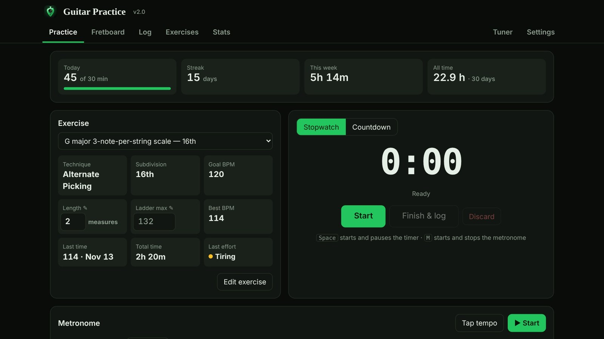

# Guitar Practice

A free app for timing, logging and tracking your guitar practice. It runs in your browser on a Mac
or a Windows PC, works offline once installed, and keeps your practice log on your own computer.
Nothing is sent anywhere.

- **Practice:** pick an exercise, time it with a stopwatch or countdown, and log the minutes, your
  tempo and how it felt. Today's minutes, your streak and your daily goal are always at the top.
- **Metronome:** drum or click sounds, tap tempo, divisions including triplets, and a beat pattern
  you draw yourself.
- **Tempo ladder:** steps the metronome up past your goal tempo and back down to build speed, with
  get-ready clicks, repeats per tempo, pause/resume, and skip or stay on a tempo.
- **Fretboard trainer:** learn every note on the neck — name it, find it, or play it into a
  microphone — with timed challenges. It logs its own time and score.
- **Tuner:** guitar or bass, standard, drop, open or custom tunings.
- **Log, Exercises and Stats:** filters, CSV export, daily minutes against your goal, and progress
  charts. Backups you can export and import.

## Get the app

1. Download **[Guitar-Practice.zip](../../releases/latest/download/Guitar-Practice.zip)** from the
   [Releases page](../../releases/latest) and unzip it. Keep the **Guitar Practice** folder
   somewhere it can stay, such as Documents.
2. **Mac:** double-click **Start Guitar Practice.command**. The first time, macOS may not open it:
   right-click it, choose **Open**, then **Open** again.
   **Windows:** double-click **Start Guitar Practice.bat**. If SmartScreen warns you, click
   **More info**, then **Run anyway**.
3. The app opens in your browser. Click **Install app** (Chrome or Edge), or choose
   **File > Add to Dock** (Safari), so it opens in its own window from then on.

The README.txt in the folder covers updating, backups and moving your log to another computer.

## Videos

An overview and a video for each part of the app: *(links to come)*

## How it's built

A single-page web app (`index.html`, plus `trainer.html` for the fretboard trainer) with a service
worker for offline use. The Start files serve the folder at `http://localhost:8642`, which lets the
browser install it and use the microphone. Every push builds `Guitar-Practice.zip` and publishes it
to Releases (`.github/workflows/release.yml`). `tutorial/` holds the frames and scripts for the
video series.
